# Dashboard Holiday Popups

Animated characters, timed popups and decorations that float over your Home Assistant dashboards, set up from one settings panel. Great for holidays and birthdays, but just as useful for **mail and package deliveries, washer and dryer done, weather, or anything else** an entity can tell you.

- **Characters** walk along the bottom or top, drift, bob, sway, circle, or fly a curved or zigzag path. Push one off the screen with a finger and it either comes back after a delay you choose, or turns itself off. You can pause it for a selected amount of time or just turn it off completely.
- **Popups** peek in from an edge on their own timer (a chosen edge, left or right at random, top or bottom at random, or any edge; a picture drawn for the left or right side is mirrored, not turned over, when it comes from the other side, while top and bottom pictures turn upside down), with an optional text banner. They never land on top of each other. You can let a finger push one back off the screen, with the same delay or turn-off choice.
- **Decorations** sit in corners or along edges (wreaths, lights). One picture can be placed in as many corners as you like, each flipped to fit. They are click-through.
- **Dates** work like a calendar: a start date, how many days it lasts, and a repeat (daily, weekly on chosen days, monthly, yearly, every N, ending never / on a date / after N times). Thanksgiving is "yearly, the 4th Thursday of November"; Santa can start December 20 for 5 days.
- **Scenes** switch a group of dated items on together on one schedule, such as Halloween.
- **Weather and Sensors**: weather and any entity state show items on their own screen.
- **Run now / Stop** shows any item or scene until you stop it. It is saved, so it survives a page refresh and a restart.
- **Controls**: a switch entity for the master switch, each scene, and each item you add (the starter items' switches are hidden until you enable them in the entity settings), plus services for automations.

## Install

1. HACS → Integrations → three dots → Custom repositories → add `https://github.com/Pjarbit/dashboard-holiday-popups` as *Integration*, then download it.
2. Restart Home Assistant.
3. Settings → Devices & services → Add integration → **Dashboard Holiday Popups**.
4. Open **Holiday Popups** in the sidebar (administrators only).
5. After you have finished installing and making your changes, **refresh your screen** (reload the dashboard page).

If you don't want it in the sidebar, you can hide the entry in Home Assistant and still reach the settings by going to `/dashboard-holiday-popups` after your Home Assistant address, for example `http://homeassistant.local:8123/dashboard-holiday-popups`. Bookmark it, or use that path as a navigation button on a dashboard. It is still administrators only.

Requires Home Assistant 2024.12.0 or newer.

# ⚠️ Make sure you refresh your screen to get the characters animated ⚠️

## Using it

The panel has four screens:

- **Dated or Manual**: items that show on dates, or all the time, and the place to turn things on by hand. Press **Add Custom Character**, **Add Custom Popup** or **Add Custom Decoration**, name it, upload an image, choose how it moves and when it shows. A birthday is a good example: you don't want a date to start it automatically, so leave its dates empty and press **Run now** on the day. It shows until you press **Stop**. The same works for a holiday: on Valentine's Day, press **Run now** on a whole scene, or on just the individual characters, popups and decorations you want.
- **Scenes**: pick a name, a repeat rule and the items to include. A scene controls only *when* its items show (schedule, Run now, on/off switch). How an item looks and moves (size, path, speed, image, dashboards, pushing aside) is always set on the item itself, never on the scene. While a scene is on, it decides for its items: their own switches are locked and the card says "On via scene". When the scene is off, each item works on its own again with its own switch and dates. Adding an item to a scene turns its own switch off, so switch it back on if you want it on its own. An item can be in several scenes and shows when any of them is on. A scene has one repeat rule, so make one scene per person or season: press **Duplicate** on a scene, then change its name, date and the optional **Name shown in banners**, which fills `{name}` in a popup's banner text while that scene shows it. **Duplicate** on an item makes a copy to change (a second witch with another path and speed, say).
- **Weather and Sensors**: items triggered by a weather entity or any other entity. Weather and sensor items cannot join a scene.
- **Settings**: master switch, how many show at once, layer, **Scale** (a percent that makes every character, popup and decoration bigger or smaller on all devices; 100 is normal), default dashboards, and the reduced-motion option.

**Run now** on an item or scene shows it right away and keeps it showing until you press **Stop** (a popup shows at once and then repeats on its normal timer). **Stop all** ends everything you started. **Turn all off** pauses every item on the current screen; there is no turn-all-on. Run now respects the cap in Settings.

### Starter set

About 60 starter items come with the integration and are created the first time you add it:

- **On from the start:** Halloween (Oct 15 to 31), Thanksgiving (Nov 22 to 28, which always includes the 4th Thursday) and Christmas (Dec 1 to 26).
- **Paused, with a date:** Groundhog Day, Valentine's Day, New Year's, Mother's Day, Father's Day, Fourth of July, Labor Day and Veterans Day. Mother's Day, Father's Day and Labor Day use the widest week the day can fall in.
- **Paused, you set the dates:** birthdays, Easter, graduation, Eid, Ramadan, Hanukkah, Yahrzeit, Lunar New Year, Vaisakhi and Vesak. Open the item, add a date trigger and switch it on.
- **Paused, you choose the entity:** washer, mail and package items, plus rain and snow (choose your weather entity and conditions).

Every item can be edited, paused or deleted. Switch off the ones you don't want from the Dated or Manual and Weather and Sensors screens, or use Turn all off.

### Gallery of the starter pictures

Every starter item, grouped by holiday. The pictures animate on GitHub. Each heading says whether the group is on from the start or paused, and what you need to add before it will show.

#### Halloween (on from the start, except the whimsical cobweb, which is paused)

| Picture | Name | Type |
|---|---|---|
| 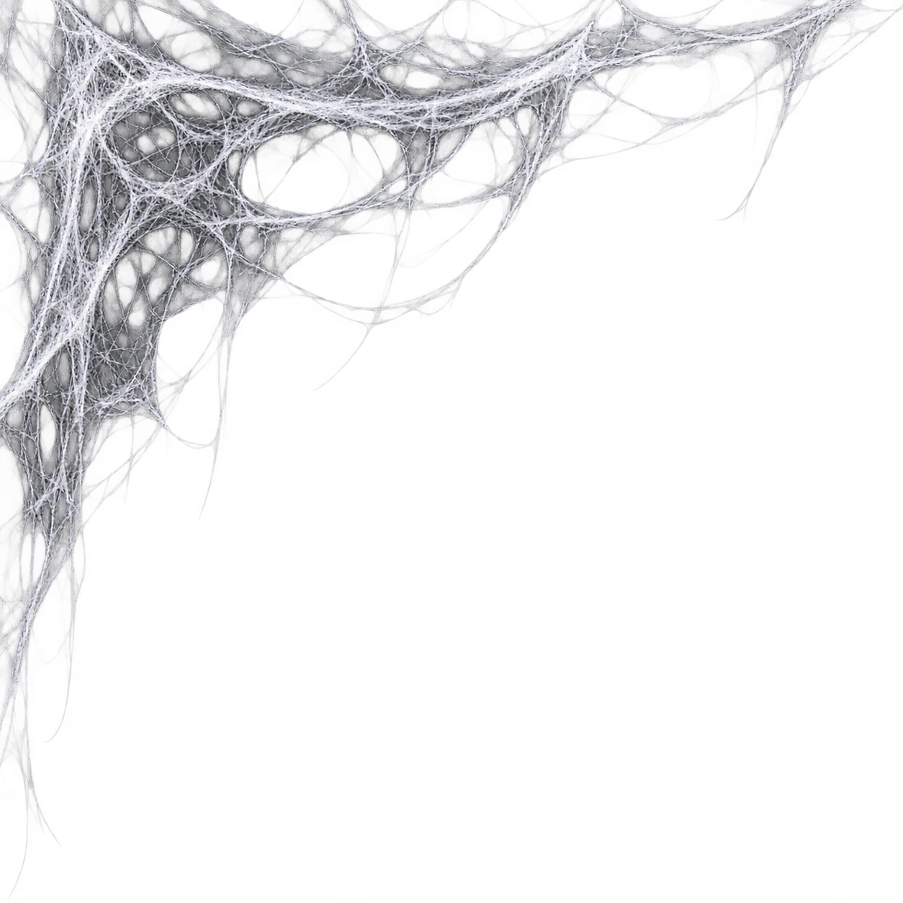 | Spooky cobweb | Decoration |
| 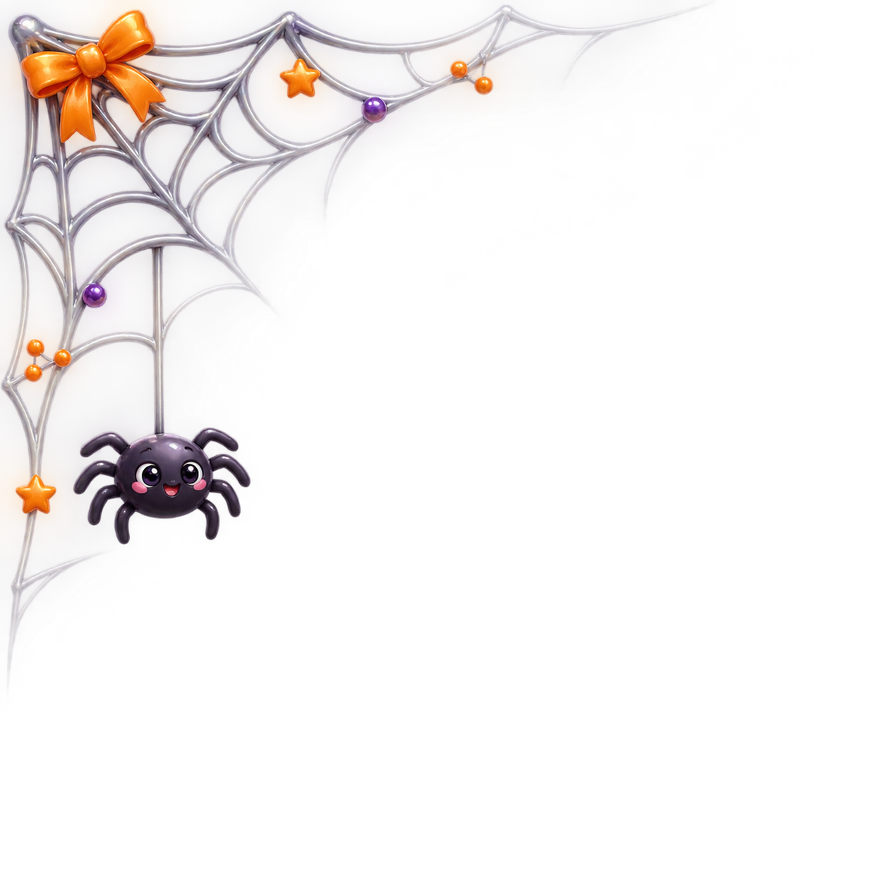 | Whimsical cobweb | Decoration |
| 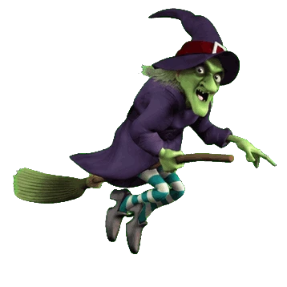 | Flying witch | Character |
| 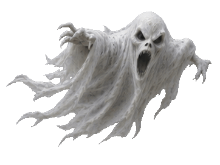 | Scary ghost | Character |
|  | Funny ghosts | Character |
|  | Frankenstein walking | Character |
|  | Frankenstein walking 2 | Character |
| 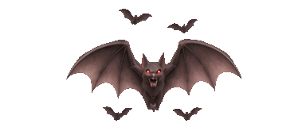 | Bats | Character |
|  | Frankenstein popup | Popup |
|  | Mummy popup | Popup |

#### Thanksgiving (on from the start)

| Picture | Name | Type |
|---|---|---|
| 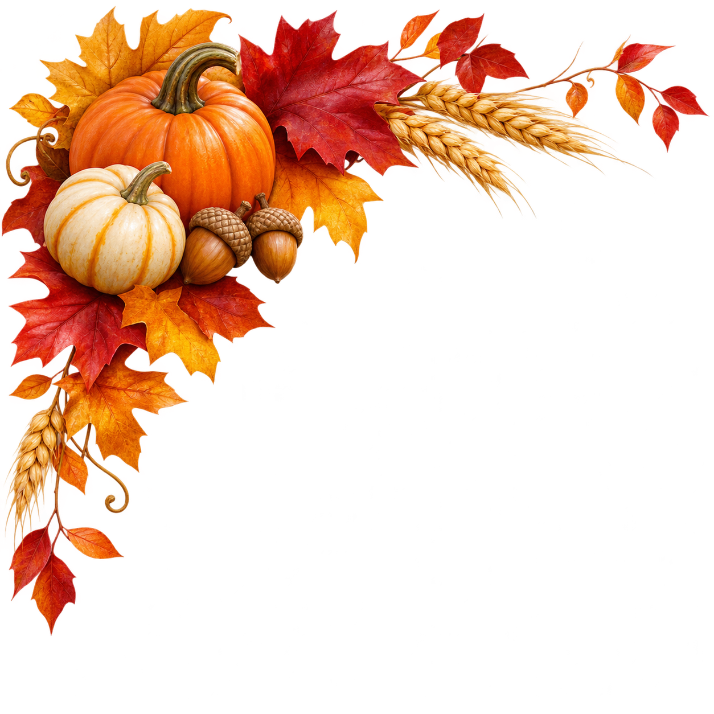 | Autumn pumpkins | Decoration |
| 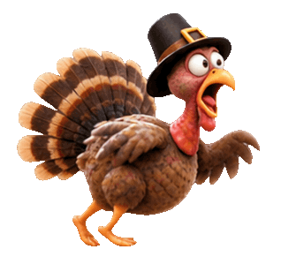 | Running turkey | Character |
| 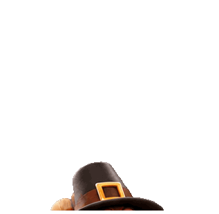 | Turkey popup | Popup |

#### Christmas (on from the start)

| Picture | Name | Type |
|---|---|---|
|  | Christmas corner | Decoration |
| 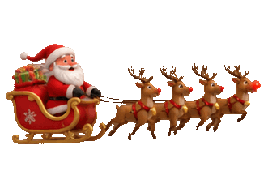 | Flying Santa | Character |
| 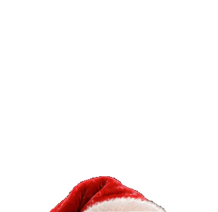 | Santa popup | Popup |

#### Birthday (paused, you set the dates)

| Picture | Name | Type |
|---|---|---|
|  | Birthday cake walking | Character |
|  | Birthday boy popup | Popup |
|  | Birthday girl popup | Popup |
|  | Birthday kids popup | Popup |

#### Easter (paused, you set the dates)

| Picture | Name | Type |
|---|---|---|
| 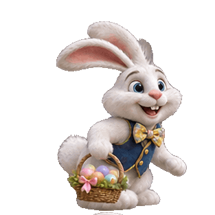 | Bouncing Easter bunny | Character |
| 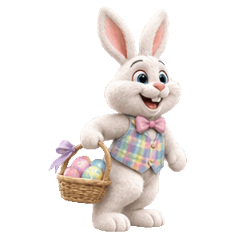 | Hopping Easter bunny | Character |
|  | Easter bunny popup | Popup |

#### Groundhog Day (paused, dates already set)

| Picture | Name | Type |
|---|---|---|
|  | Groundhog walking | Character |
|  | Groundhog popup | Popup |

#### Valentine's Day (paused, dates already set)

| Picture | Name | Type |
|---|---|---|
| 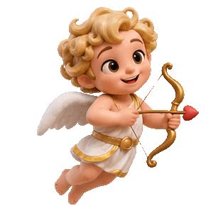 | Flying cupid | Character |
| 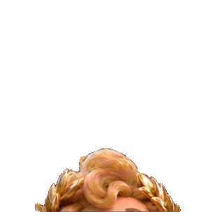 | Cupid popup | Popup |

#### New Year's (paused, dates already set)

| Picture | Name | Type |
|---|---|---|
|  | New Year's walking | Character |
| 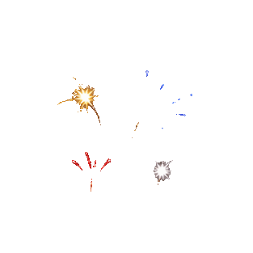 | Fireworks | Character |

#### Mother's Day (paused, dates already set)

| Picture | Name | Type |
|---|---|---|
|  | Mother's Day popup | Popup |

#### Father's Day (paused, dates already set)

| Picture | Name | Type |
|---|---|---|
|  | Father's Day banner | Character |
|  | Father's Day popup | Popup |

#### Fourth of July (paused, dates already set)

| Picture | Name | Type |
|---|---|---|
| 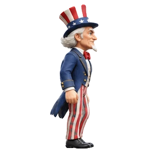 | Uncle Sam walking | Character |
|  | Uncle Sam popup | Popup |

#### Labor Day (paused, dates already set)

| Picture | Name | Type |
|---|---|---|
|  | Labor Day banner | Character |

#### Veterans Day (paused, dates already set)

| Picture | Name | Type |
|---|---|---|
|  | Veterans soldiers | Character |
|  | Veterans soldiers in a line | Character |
|  | Soldier popup | Popup |

#### Graduation (paused, you set the dates)

| Picture | Name | Type |
|---|---|---|
|  | Graduates walking | Character |
|  | Graduates popup | Popup |

#### Eid (paused, you set the dates)

| Picture | Name | Type |
|---|---|---|
| 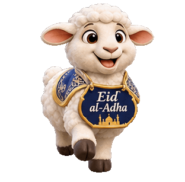 | Eid al-Adha | Character |
|  | Eid al-Fitr | Character |

#### Ramadan (paused, you set the dates)

| Picture | Name | Type |
|---|---|---|
|  | Ramadan lantern | Character |

#### Hanukkah (paused, you set the dates)

| Picture | Name | Type |
|---|---|---|
|  | Menorah | Character |
|  | Dreidel | Character |
| 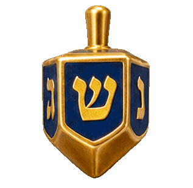 | Spinning dreidel | Character |

#### Yahrzeit (paused, you set the dates)

| Picture | Name | Type |
|---|---|---|
|  | Yahrzeit candle | Character |

#### Lunar New Year (paused, you set the dates)

| Picture | Name | Type |
|---|---|---|
|  | Chinese New Year dragon | Character |

#### Vaisakhi (paused, you set the dates)

| Picture | Name | Type |
|---|---|---|
| 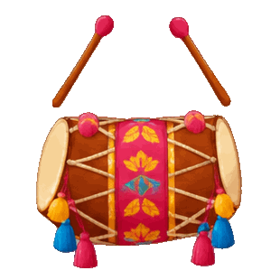 | Drums (Vaisakhi) | Character |

#### Vesak (paused, you set the dates)

| Picture | Name | Type |
|---|---|---|
|  | Lotus flower (Vesak) | Character |

#### Washer (paused, you choose the entity)

| Picture | Name | Type |
|---|---|---|
| 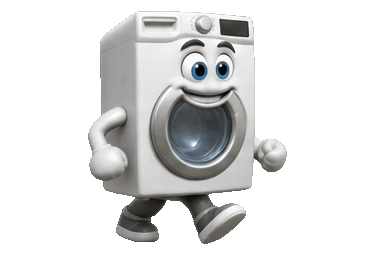 | Washer walking | Character |
| 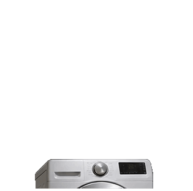 | Washer popup | Popup |

#### Mail (paused, you choose the entity)

| Picture | Name | Type |
|---|---|---|
|  | Mail flying | Character |
| 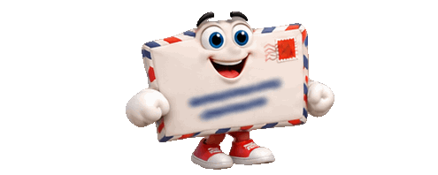 | Mail walking | Character |
|  | Mail popup | Popup |

#### Package (paused, you choose the entity)

| Picture | Name | Type |
|---|---|---|
| 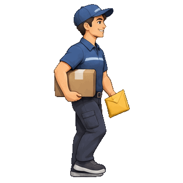 | Package delivery | Character |
|  | Package popup | Popup |

#### Weather (paused, you choose the entity)

| Picture | Name | Type |
|---|---|---|
| 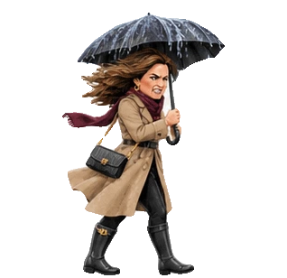 | Rain umbrella | Character |
| 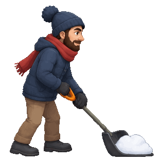 | Shoveling snow | Character |
| 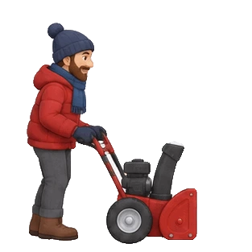 | Snow blower | Character |

### Adding your own pictures

Upload them in the panel itself; there is no folder to copy files into.

1. Open **Holiday Popups** in the sidebar.
2. On **Dated or Manual** or **Weather and Sensors**, press **Add Custom Character**, **Add Custom Popup** or **Add Custom Decoration**, or press **Edit** on an existing item.
3. In the **Basics** box, under **Image**, press **Choose file** and pick your GIF, WebP, APNG or PNG (up to 5 MB).
4. Set its size, how it moves and when it shows, then **Save**.

Uploads are stored for you in `/config/dashboard_holiday_popups/`. To swap the picture on an existing item, edit it and choose a new file.

Leave **Dashboards** empty to use the default list from Settings; an empty default list means every dashboard. Settings pages, developer tools and the profile page never show anything.

### Services

| Service | Fields | What it does |
|---|---|---|
| `dashboard_holiday_popups.show_popup` | `item`, `message` (optional), `duration` (optional) | Shows a popup or character for a moment, then it goes away (use Run now in the panel to keep one showing). `item` is the item's name. |
| `dashboard_holiday_popups.hide_all` | none | Hides everything shown right now. |
| `dashboard_holiday_popups.set_enabled` | `item`, `enabled` | Pauses or resumes an item. |

```yaml
actions:
  - action: dashboard_holiday_popups.show_popup
    data:
      item: Package delivered
      message: A package is at the door
```

### Pushing things aside

Characters and popups each have a **When pushed away** setting:

- **Come back after a delay**: it leaves and returns after the number of seconds you set (popups return on their normal timer once the delay is over).
- **Turn it off**: it switches itself off, like its own switch, and stays off until you switch it on. An item in a scene is muted only for the current run of that scene (in every scene that is showing it) and returns with the next one; its card shows "Pushed away for now" with a **Bring back** button. If it was started with Run now, it stops. If the server never confirms, the item comes back after a few seconds.

Characters can be pushed by default; popups are tap-through until you switch pushing on for them. "Turn it off" works from any signed-in user, such as a wall tablet that is not an administrator, and it can only switch an item off.

## Making your images

- Transparent background. Use animated **WebP** if you can (smooth edges); GIF only has on/off transparency, so edges look jagged. GIF, WebP, APNG and PNG up to 5 MB are accepted.
- **One image only.** The character is flipped automatically when it walks the other way, so keep **text and logos out of the art** (they would appear mirrored). Draw it facing right. If your art does have words, set its direction to **Left to right only** so it is never flipped.
- Walking or flying loop only, seamless, feet at the bottom edge. Roughly 200–360 px tall keeps files small.
- Popup art: draw it so its body is cut off at the edge it comes in from. New popups come in from the **left** by default (change this under **New popups start from** in Settings), so draw the character peeking in from the left side. Each popup also has **Picture is drawn for**; if it comes in from a different edge, the integration turns the picture from there. A picture drawn for the bottom turns upside down on the top edge, so keep one edge per character where you can.
- Use your own art or properly licensed art. Protected characters and mascots are not bundled and should not be shared in public.

### Make a picture with an AI assistant

Copy the text below into an AI assistant that can write and run code (for example Claude), then replace the part in square brackets with what you want. Image-only chat tools cannot produce a finished transparent animation on their own, so the assistant needs to be able to run code or use an image-editing tool.

```text
I want a picture for the Home Assistant integration "Dashboard Holiday Popups".
What I want: [describe it, e.g. "a cartoon pumpkin character hopping along",
"a snowman waving", "a wreath for a corner"].
Type: [CHARACTER that moves across the screen | POPUP that peeks in from an edge | DECORATION for a corner].

Requirements:
- Original art only. Do not copy or imitate any existing character, mascot, logo or brand.
- No text, numbers or logos anywhere in the picture (it gets flipped left to right).
- Fully transparent background. Smooth, anti-aliased edges (real alpha, not on/off).
- File format: animated WebP for characters and popups; PNG for decorations.
  If WebP is not possible, use APNG or GIF. Never more than 5 MB; aim for under 500 KB.
- Height about 230 px (width follows). Every frame has the same canvas size.
- CHARACTER: draw it facing RIGHT, feet on the bottom edge of the canvas, and make a
  seamless walking or flying cycle of 8 to 16 frames at 10 to 12 frames per second that
  loops with no jump. No waving or greeting.
- POPUP: draw it peeking in from the LEFT edge of the screen (the body cut off on the
  left side, the character looking into the screen), with a short, seamless loop of 8 to 16
  frames.
- DECORATION: one still picture drawn for the TOP LEFT corner of the screen, with the
  art touching the top and left edges. The integration flips it for other corners.

Steps: build the frames, remove or never draw a background, assemble the animation,
then check that the file has transparency, loops cleanly, and is under 5 MB.
Give me the finished file to download.
```

Then upload the file as described in "Adding your own pictures". If the first try has a rough edge, a white halo or a jump at the loop point, tell the assistant exactly what you see and ask it to fix that.

## Notes

- You can run as many popups and floaters as you want. Each one takes computing power and may slow down your dashboard and your Home Assistant experience. We recommend no more than three, but your results may vary. The cap in Settings (default 3, up to 10) applies to characters and to popups separately. Decorations are not counted.
- If your device is set to reduce motion, characters and popups stay hidden (decorations still show) unless you press Run now. You can turn this off in Settings.
- Uploaded images are stored in `/config/dashboard_holiday_popups/`. Each changed image gets a new name, and each release is served from a new URL, so updates show up without any cache steps.
- The settings panel is plain JavaScript, with no external libraries.
